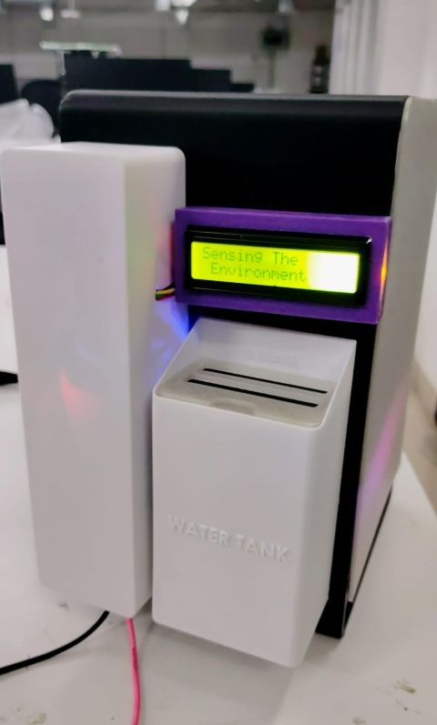
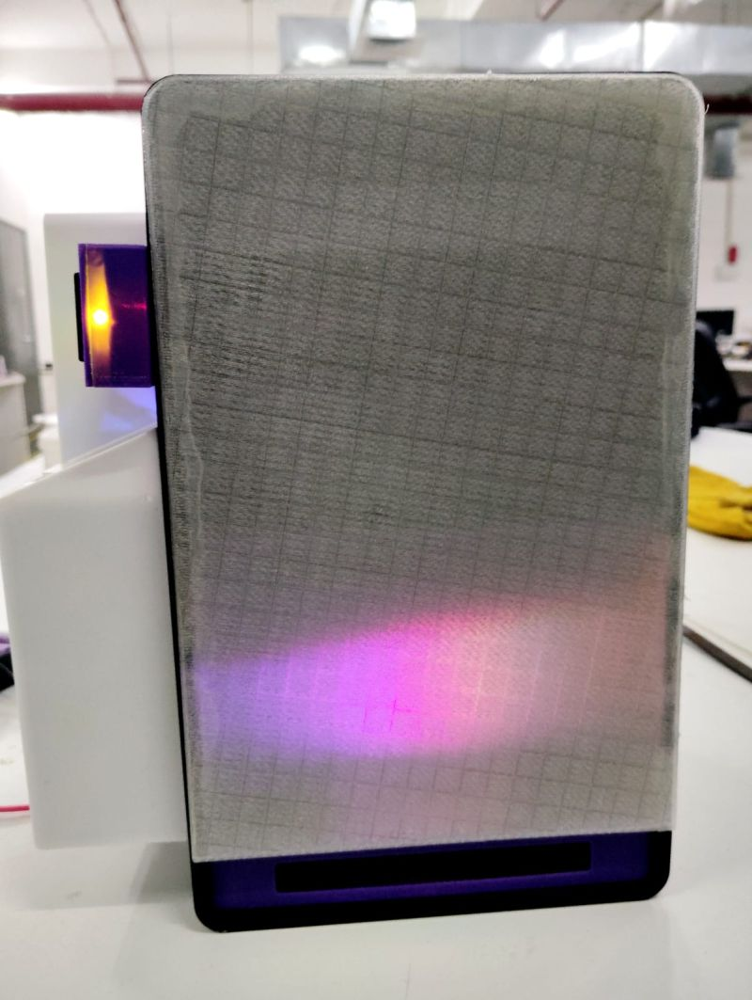
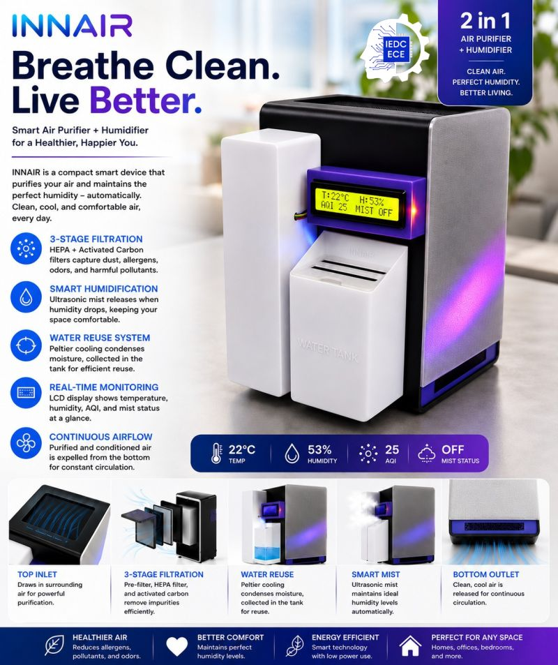

**Air Purifier with Automatic Humidity Control**

**Project Overview**
An Arduino-based air purification and environmental monitoring system designed to monitor gas-related parameters and automatically regulate humidity.
**Project Features**
1. Air-quality monitoring using MQ-series gas sensors.
2. Temperature and humidity monitoring using DHT11.
3. Automatic humidity control using a Peltier module and mist maker.
4. Air circulation using fans.
5. Real-time readings displayed on an I2C LCD.

**Hardware Components**
1. Arduino Nano
2. MQ-2, MQ and MQ-135 sensors
3. DHT11 temperature and humidity sensor
4. I2C LCD display
5. Fans, Peltier module and mist maker
6. Supporting electronic components

**Project Images**

Prototype — Image 1

Prototype — Image 2

Prototype — Image 3

**Source Code**
The Arduino source code is available in [`code.ino`](code.ino).

**Author**
Dipan Guha
